# Flow Explainer

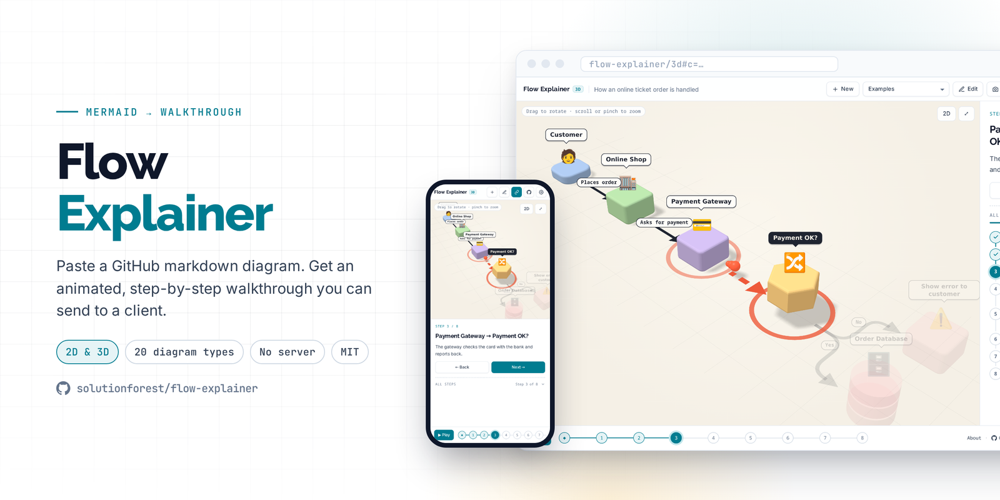

[](https://flow-explainer.laravel.cloud/) [](LICENSE)   

Paste a GitHub markdown diagram, get an animated step-by-step walkthrough you can send to a client.

Built by [Solution Forest Limited](https://solutionforest.net/), a Hong Kong digital agency.

Flow Explainer reads a [Mermaid](https://mermaid.js.org/) diagram (flowchart, sequence, state, class, ER, gantt, pie, mindmap, journey, timeline, quadrant, git graph, xychart, sankey, block, architecture, C4, kanban, packet or requirement) and plays it one arrow at a time: the camera moves to each step, a dot travels along the arrow, and a side panel explains what is happening in plain language. It comes in a flat isometric **2D** version and a rotatable **3D** version, and it can export a clean PNG for your README.

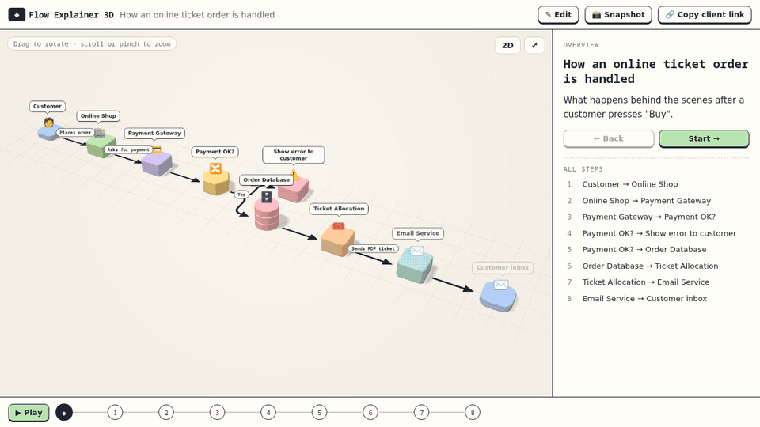

No build step, no server and no account. It is two HTML files plus Three.js, and your diagram never leaves the browser.

## How it works


1. You paste a GitHub markdown file that contains a mermaid diagram.
2. Pressing **Render** hands the text to the built-in reader. Nothing is uploaded.
3. Every box becomes a block and every arrow becomes one step, played with the camera following along.
4. **Snapshot** checks for overlapping labels and saves a PNG for your README.
5. **Copy client link** packs the whole diagram into the link itself.
6. Your client opens the link and presses **Play**: the same walkthrough, without the editing tools.

The diagram above is GitHub's own Mermaid rendering. Here is the same markdown after going through Flow Explainer's **Snapshot** button:

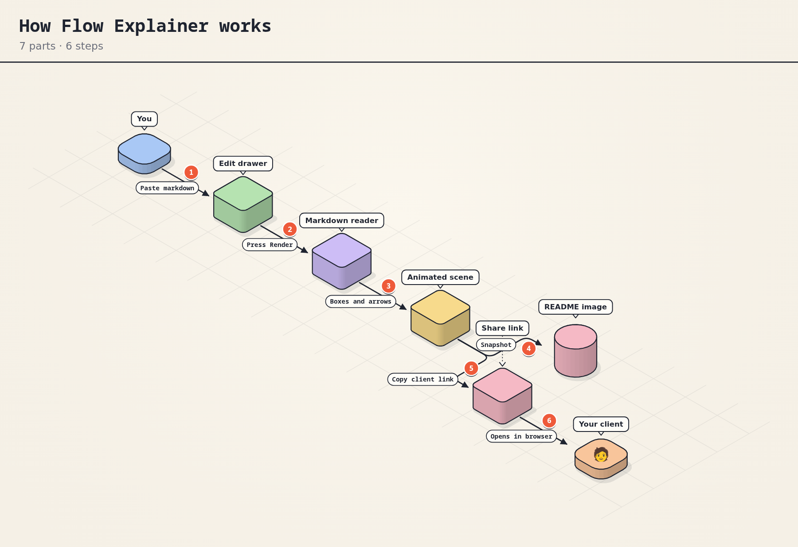

The full source of that picture is [`examples/how-it-works.md`](examples/how-it-works.md). You can paste it straight into the editor.

## Quick start

Try it online at **[flow-explainer.laravel.cloud](https://flow-explainer.laravel.cloud/)** ([3D](https://flow-explainer.laravel.cloud/3d)), or run it yourself:

1. Open `index.html` (2D) or `3d.html` (3D) from any static file server — see [Run it yourself](#run-it-yourself).
2. Press **New** (or **Edit** to change the current one), paste your markdown, then **Render ▶**. **Use template** fills in a starter file, **Open .md** loads one from your computer, and the **Examples** menu in the top bar loads a sample.
3. Press **▶ Play**, or step with **Next / Back**, the ← → keys, or the numbered timeline at the bottom.
4. Press **Copy client link** and send it. The link opens in view-only mode, without Edit or Snapshot, and in the diagram style you picked.
5. Open **⚙ Settings** (top right) to pick a diagram style or switch between 3D and 2D.
6. Click **Flow Explainer** (top left) or **About** in the footer for a short intro, the privacy notes and the GitHub link.

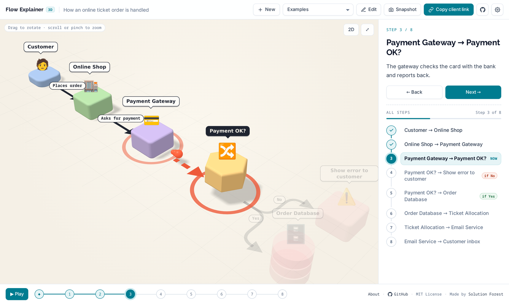

| On a phone | Paste your markdown |
|---|---|
| 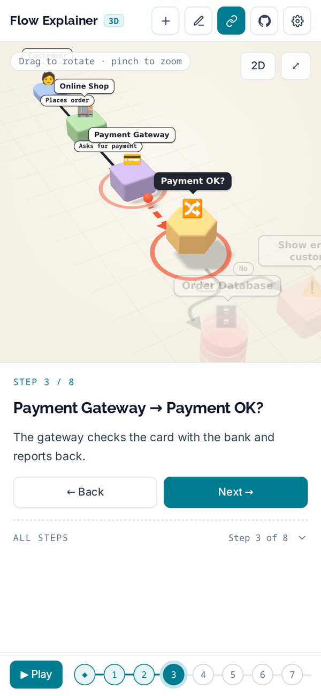 | 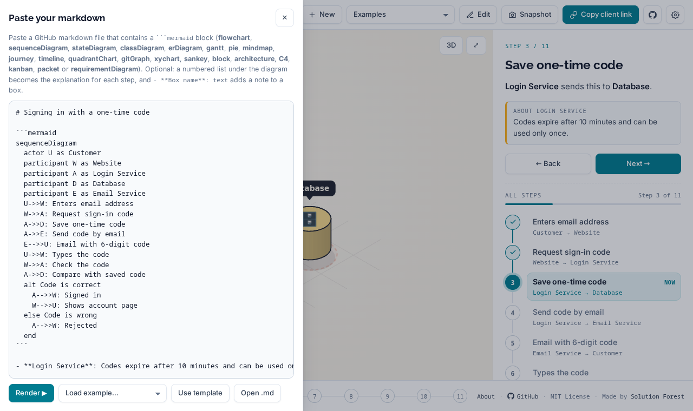 |

| Settings: diagram style | Copy client link |
|---|---|
| 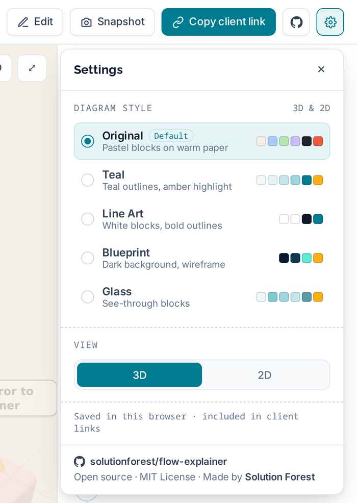 | 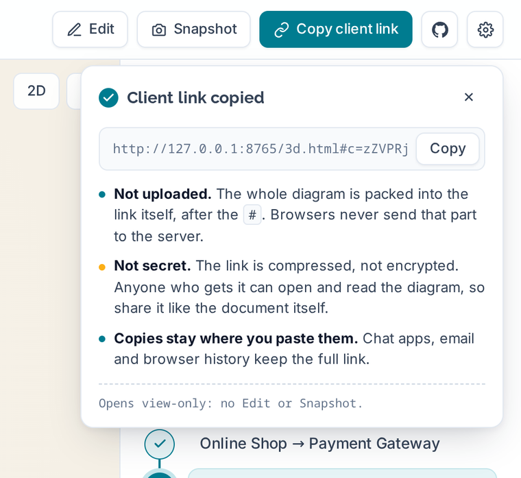 |

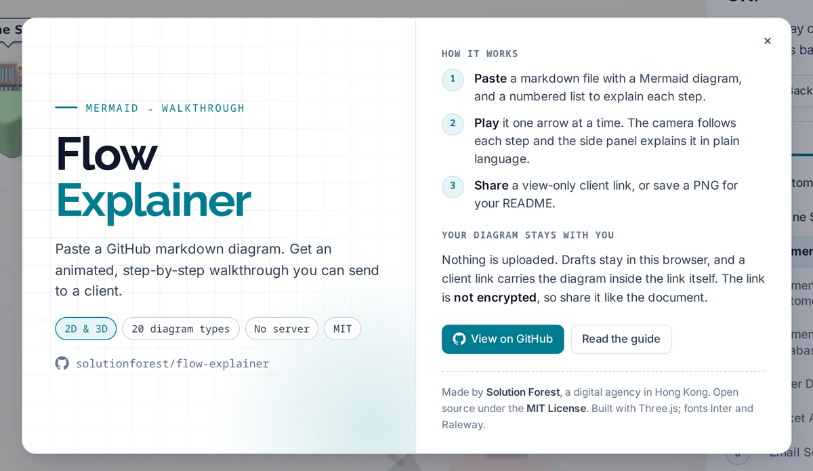

The **2D / 3D** button in the corner of the diagram (or **⚙ Settings → View**) switches views and keeps the same diagram. The layout adapts to phones and tablets: the step panel moves under the diagram and **All steps** folds up.

## Writing the markdown

A file has up to three parts. Only the diagram is required.

````markdown
# How an online ticket order is handled          ← title (optional)

What happens behind the scenes after a customer presses "Buy".   ← intro (optional)


1. The customer picks a ticket on the website and presses **Buy**.   ← one line per arrow, in order
2. The shop never touches card details. It hands the customer to the payment gateway.
3. The gateway checks the card with the bank and reports back.
4. If the payment fails, the customer sees a clear message. Nothing is charged.
5. If the payment succeeds, the order is saved as **paid**.

- **Order Database**: The single record of who bought what.   ← "About" note shown with that box
````

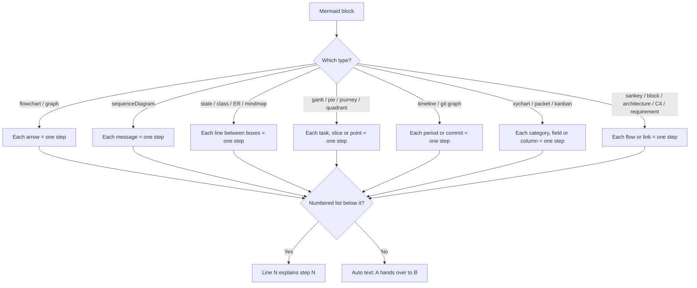

**Tips for client-friendly walkthroughs**

- Write the numbered list. Without it the step text is generated ("Online Shop hands over to Payment Gateway"), which works but reads dry.
- Keep box names short. Long names are the main cause of overlapping labels.
- Keep one scene to about 15–20 boxes. Several mermaid blocks in one file become separate scenes you pick from a dropdown.
- Box icons are picked from the name (database, email, payment, user, and so on). Emoji in the label work too.

### Supported Mermaid

Besides flowcharts and sequence diagrams, eighteen more Mermaid types are turned into the same step-by-step walkthrough, each with plain-language step text written for you. Each one has a ready-to-paste file in [`examples/`](examples/).

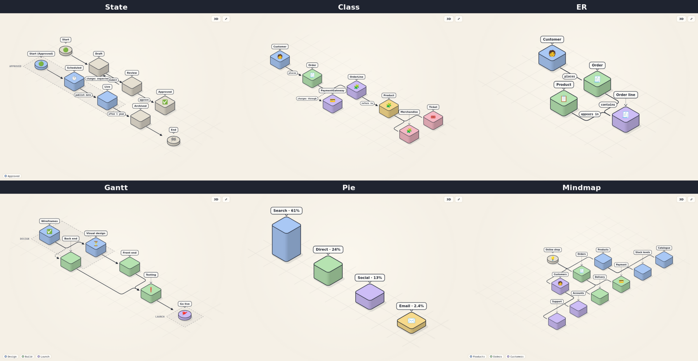

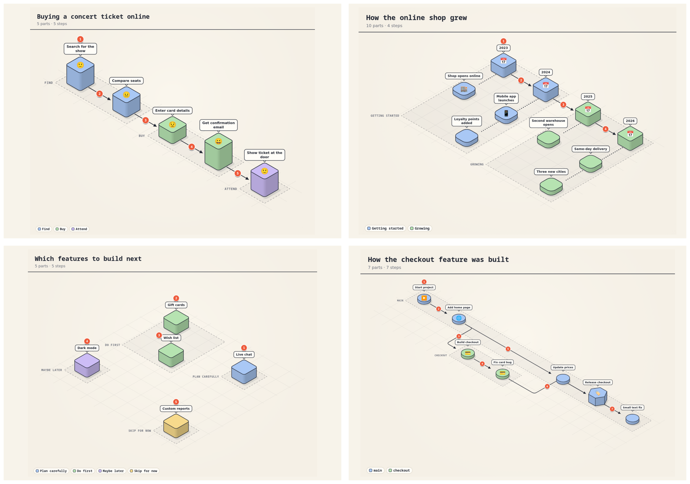

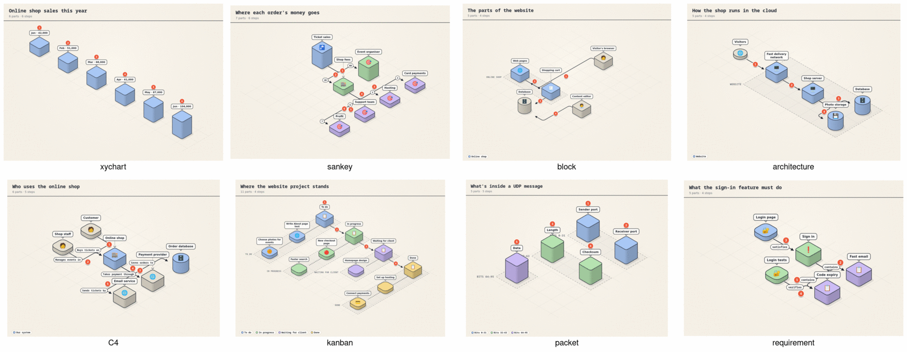

| Type | What one step shows | Example |
|---|---|---|
| State | One change, e.g. "When **approve** happens, **Review** changes to **Approved**." | [`article-lifecycle.md`](examples/article-lifecycle.md) |
| Class | One relationship, e.g. "**Ticket** is a kind of **Product**, so it gets everything Product has." | [`shop-classes.md`](examples/shop-classes.md) |
| ER | One relationship, e.g. "Each **Customer** places **zero or more** order. Each order is linked to **exactly one** customer." | [`shop-database.md`](examples/shop-database.md) |
| Gantt | One task, with its dates and what it waits for | [`launch-plan.md`](examples/launch-plan.md) |
| Pie | One slice and its share of the total | [`traffic-sources.md`](examples/traffic-sources.md) |
| Mindmap | One branch, e.g. "**Orders** includes **Payment**." | [`shop-mindmap.md`](examples/shop-mindmap.md) |
| Journey | One task and how it feels, e.g. "Next: **Enter card details**. This feels **frustrating** for **Customer** and **Shop** (2 out of 5). A pain point worth fixing." Block height and face follow the score. | [`customer-journey.md`](examples/customer-journey.md) |
| Timeline | One period with everything that happened in it, e.g. "**2024**: **Mobile app launches** and **Loyalty points added**." | [`shop-timeline.md`](examples/shop-timeline.md) |
| Quadrant | One point and where it lands, e.g. "**Gift cards** is **low effort** and **high value**, so it lands in **Do first**." | [`feature-priorities.md`](examples/feature-priorities.md) |
| Git graph | One commit or merge, e.g. "A separate copy called **checkout** splits off from **main** at **Add home page**…" | [`release-history.md`](examples/release-history.md) |
| XY chart | One category, e.g. "In **May**: **87,000**, up 43% from Apr." Bar height follows the value; the highest and lowest points are called out. | [`monthly-sales.md`](examples/monthly-sales.md) |
| Sankey | One flow, e.g. "**Shop fees** sends **7** to **Profit** — 35% of everything leaving Shop fees." | [`where-money-goes.md`](examples/where-money-goes.md) |
| Block | One link between blocks, or one row when there are no links. Blocks keep their `columns` grid position. | [`website-parts.md`](examples/website-parts.md) |
| Architecture | One connection, e.g. "**Shop server** sends to **Database**." Groups become zones; database, disk, server and internet icons are kept. | [`cloud-setup.md`](examples/cloud-setup.md) |
| C4 | One relationship, e.g. "**Online shop** takes payment through **Payment provider** (using HTTPS)." Boundaries become zones. | [`shop-c4.md`](examples/shop-c4.md) |
| Kanban | One column, e.g. "**In progress** has **2 cards**: **New checkout page** and **Faster search**. **New checkout page** is high priority." | [`project-board.md`](examples/project-board.md) |
| Packet | One field, e.g. "Next, bits **16–31** hold **Receiver port** (16 bits, 2 bytes)." Each 32-bit row is a zone. | [`network-message.md`](examples/network-message.md) |
| Requirement | One relationship, e.g. "**Login page** meets the requirement **Sign in**." ID, text, risk and test method become the box note. | [`login-requirements.md`](examples/login-requirements.md) |


| Feature | Supported |
|---|---|
| `flowchart` / `graph` (any direction; the layout always runs along the isometric diagonal) | ✅ |
| Shapes: `[box]` `([rounded])` `{decision}` `[(database)]` `((circle))` | ✅ |
| Arrow labels `-->\|text\|` or `-- text -->`, dotted arrows `-.->` | ✅ |
| Thick arrows `==>`, chains `A --> B --> C`, `A & B --> C` | ✅ (thick drawn as normal) |
| `subgraph` (shown as coloured zones with a legend) | ✅ |
| `sequenceDiagram` with `actor`, `participant`, `->>`, `-->>` | ✅ |
| `alt` / `else` / `opt` / `loop` / `par` blocks (shown as step tags) | ✅ |
| `stateDiagram` / `stateDiagram-v2`: `[*]` start and end, transition labels, composite `state X { }` (zones), `<<choice>>` / `<<fork>>` / `<<join>>`, notes and descriptions (shown as box notes) | ✅ |
| `classDiagram`: classes with members (shown as box notes), all relationship arrows (inheritance, composition, aggregation, association, dependency, realization) with labels and cardinality, `namespace` (zones), `note for` | ✅ |
| `erDiagram`: entities with attributes (shown as box notes), crow's-foot cardinality turned into plain sentences, identifying `--` and non-identifying `..` | ✅ |
| `gantt`: sections (zones), `done` / `active` / `crit` / `milestone`, `after` dependencies, dates and durations; steps play in start-date order | ✅ (`excludes` weekends ignored) |
| `pie`: each slice becomes a block whose height matches its value; steps go from biggest to smallest | ✅ |
| `mindmap`: indentation tree, node shapes, each main branch gets its own colour | ✅ (`::icon` ignored) |
| `journey`: sections (zones), score 1–5 (block height and a face icon), actors; steps play in order and low scores are flagged as pain points | ✅ |
| `timeline`: sections (zones), periods with one or more events (also on `:` continuation lines) | ✅ |
| `quadrantChart`: axis labels, quadrant names (zones), points placed by their x/y values; steps play quadrant by quadrant | ✅ (point styling ignored; points too close together are nudged apart) |
| `gitGraph`: `commit` (`id`, `tag`, `type`), `branch`, `checkout` / `switch`, `merge`, `cherry-pick`; each branch gets its own lane and colour | ✅ (`order:` and commit direction `TB`/`BT` ignored) |
| `xychart-beta`: `x-axis` list or range, `y-axis` range, any number of `bar` and `line` series (each series is a row) | ✅ (`horizontal` ignored) |
| `sankey-beta`: `from,to,value` lines (quoted names allowed); block height follows how much passes through | ✅ |
| `block-beta`: `columns`, spans `a:2`, `space`, nested `block … end` (zones), shapes, block arrows, links with labels | ✅ (styles ignored) |
| `architecture-beta`: `group` (zones, nested), `service` with icons, `junction`, edges `a:R --> L:b` | ✅ (edge sides ignored; layout is automatic) |
| C4 (`C4Context`, `C4Container`, `C4Component`, `C4Dynamic`, `C4Deployment`): people, systems, containers, components, `Db`/`Queue`/`_Ext` variants, boundaries and deployment nodes (zones), `Rel` / `BiRel` / `Rel_Back` / `RelIndex` | ✅ (`Update…Style` and layout hints ignored) |
| `kanban`: columns (zones) and cards, with `assigned`, `priority` and `ticket` metadata | ✅ |
| `packet-beta` / `packet`: `0-15: "Field"` and `+16: "Field"`; one 32-bit row per zone | ✅ |
| `requirementDiagram`: all requirement kinds, `element`, the seven relationship types (forward and `<-` reverse) | ✅ (styles ignored) |
| Other types (e.g. radar, treemap, zenuml) | ❌ shows "not supported yet" |

## Snapshot: a README picture with an overlap check

When you write a README you want a picture of the diagram, and you want to be sure no label is hiding another one. **Snapshot** (editing view only) does both.

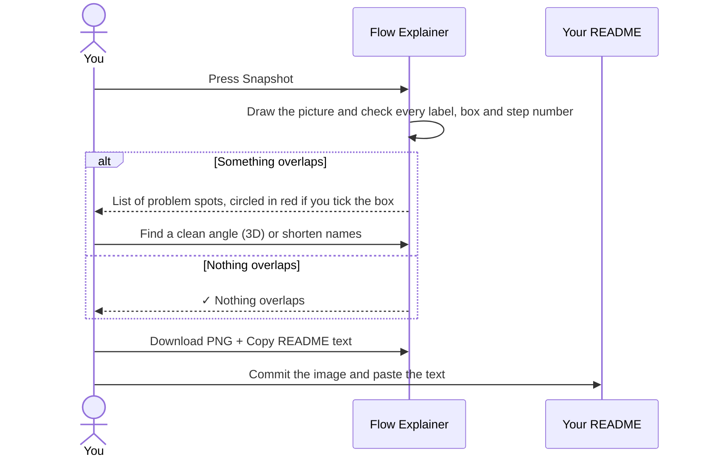


- **Preview** with the diagram title on top and numbered markers on each arrow that match the step list.
- **Credit line** (on by default, untick to remove): a thin strip at the bottom with the Flow Explainer icon, *Made with Flow Explainer*, `flow-explainer.laravel.cloud` and *by Solution Forest*.
- **Overlap check:** "✓ Nothing overlaps", or a list such as *label "Order Database" covers box "Show error to customer"*. A label sitting on an arrow line is marked **minor**.
- **2D** moves labels up or sideways automatically to make room.
- **3D** labels stay with their blocks, so **Find a clean angle** tries 64 camera angles and keeps the one with the fewest overlaps. **What I see now** uses your current camera.
- **Download PNG** (about 1800–2200 px wide), **Copy image**, and **Copy README text**, which gives you this, ready to paste:

  ```markdown
  

  1. **Customer → Online Shop** — The customer picks a ticket on the website and presses **Buy**.
  2. **Online Shop → Payment Gateway** — The shop never touches card details. …
  ```

Every image in this README was made this way. Here is the 3D export of the ticket example after **Find a clean angle**:

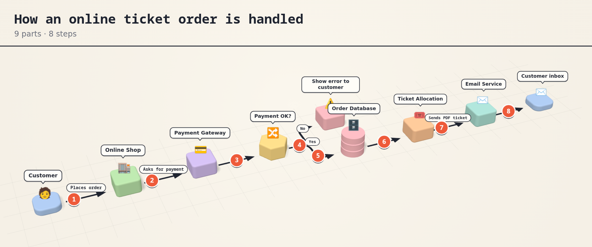

## 2D or 3D?

| | 2D (`index.html`) | 3D (`3d.html`) |
|---|---|---|
| Look | Flat isometric SVG, like a technical illustration | Real 3D blocks with soft shadows |
| Camera | Pan and zoom | Drag to rotate, scroll or pinch to zoom, shift-drag to move |
| Labels | Rearranged automatically to avoid overlaps | Fixed to blocks; pick a clean angle instead |
| Weight | One file, no dependencies | One file + Three.js (`vendor/`, ~800 KB) |
| Best for | README images, older phones | Client meetings and demos |

If a browser has no WebGL, the 3D page opens the 2D page automatically.

## Diagram styles

Open **⚙ Settings** to change how the diagram looks. The same style is used in 2D and 3D, it is saved in your browser, and a client link opens with the style you picked.

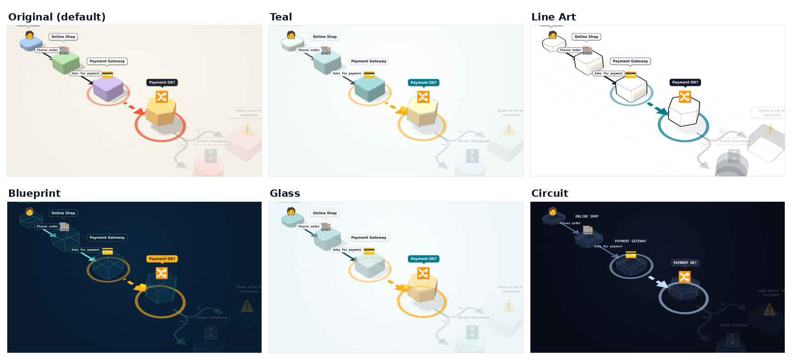

| Style | Look |
|---|---|
| **Original** (default) | Pastel blocks on warm paper, orange-red highlight |
| Teal | Pale teal blocks with teal outlines, amber highlight |
| Line Art | White blocks with bold black outlines |
| Blueprint | Dark background, cyan wireframe blocks |
| Glass | See-through blocks |

Each style is one entry in the `STYLES` list in `index.html` (background, block colours, outline, highlight, label colours, and the 3D material). To add a style, copy an entry, change the values, and run `python3 tools/sync-parser.py` so `3d.html` gets it too. The site itself always uses the Solution Forest colours; only the diagram changes.

## Run it yourself

Any static file server works. The 3D page loads Three.js as an ES module, so open it over `http://`, not `file://`.

```bash
git clone https://github.com/solutionforest/flow-explainer.git
cd flow-explainer
python3 -m http.server 8000
# 2D: http://localhost:8000/index.html
# 3D: http://localhost:8000/3d.html
```

To host it, upload the folder to GitHub Pages, Cloudflare Pages, Netlify, S3 or any web server. Both `/3d.html` and an extensionless `/3d` path work.

## Privacy

- Your markdown is kept in your browser's local storage (`flowx.md`) so it survives a reload.
- A client link stores the diagram compressed inside the part of the address after `#`. Browsers never send that part to a server, so the host only sees a request for the page.
- Anyone who has a client link can read the diagram, so treat it like the document itself. The link is compressed, not encrypted. **Copy client link** shows this reminder every time.
- Chat apps, email and browser history keep the full link wherever you paste it.
- The page loads no fonts, scripts or trackers from other sites. Everything it needs is in this repository.

## Project layout

```
index.html          2D version (SVG, no dependencies)
3d.html             3D version (Three.js)
vendor/             Three.js 0.187.0 (three.module.js + three.core.js, MIT)
                    Inter and Raleway web fonts (latin subset, SIL OFL 1.1, licences next to them)
examples/           Sample markdown files, ready to paste
tools/sync-parser.py  Copies the shared parser and diagram styles from index.html into 3d.html
docs/images/        Images used in this README
```

Both pages share the same markdown reader, step panel, timeline, settings and client-link code, copied into each file so each one stands alone. Edit the parser (everything between `/* ---------- markdown` and `/* ---------- layout`) and the diagram styles block (`/* ---------- diagram styles + settings` … `end of diagram styles + settings`) in `index.html`, then run `python3 tools/sync-parser.py` to copy them into `3d.html`.

## Known limits

- Dense diagrams can have crossing arrows; split them into several scenes.
- In the overview of a long flow, far-away blocks look small until you start stepping.
- The interface is in English. Diagram text can be any language, including Chinese.
- Copy image depends on browser clipboard support; use Download PNG where it is blocked.

## About

Flow Explainer is made by [Solution Forest Limited](https://solutionforest.net/), a digital agency in Hong Kong. We use it to explain system designs and project plans to our clients.

## License

[MIT](LICENSE) © Solution Forest Limited. Three.js is MIT-licensed by the three.js authors. Inter and Raleway are under the SIL Open Font License 1.1.
