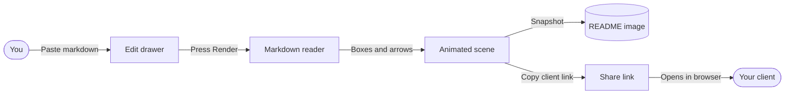

# How Flow Explainer works

1. You paste a GitHub markdown file that contains a mermaid diagram.
2. Pressing **Render** hands the text to the built-in reader. Nothing is uploaded.
3. Every box becomes a block and every arrow becomes one step, played with the camera following along.
4. **📸 Snapshot** checks for overlapping labels and saves a PNG for your README.
5. **Copy client link** packs the whole diagram into the link itself.
6. Your client opens the link and presses **Play**: the same walkthrough, without the editing tools.

- **Markdown reader**: Understands flowcharts and sequence diagrams, plus your numbered list as narration.
- **Share link**: The diagram lives inside the link, so there is no server or account involved.
