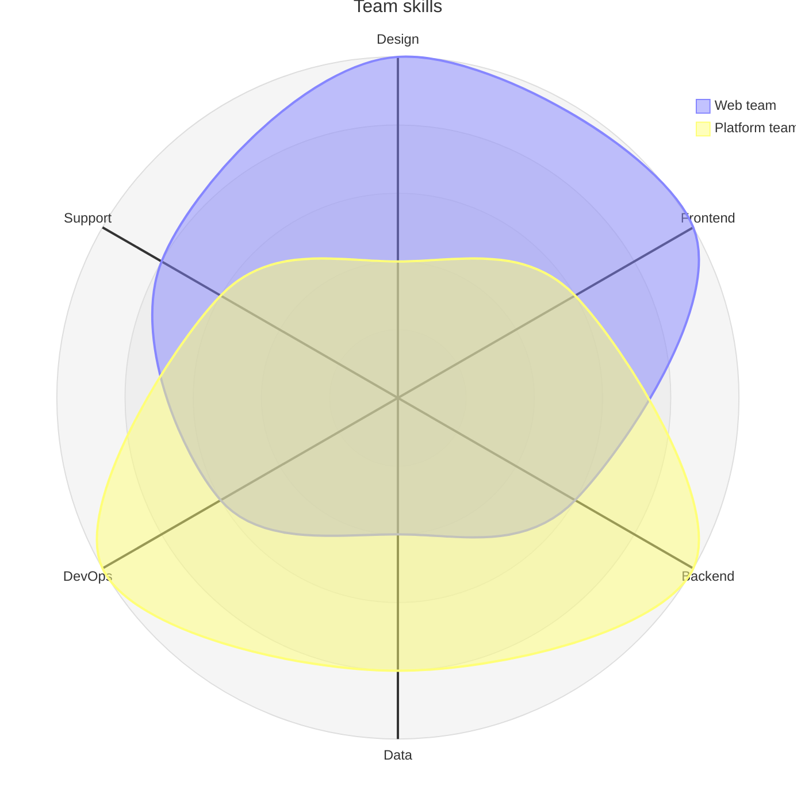

# How our two teams compare

A quick look at where each team is strong, scored from 1 to 5.

1. The web team leads on design; the platform team helps when a screen needs a second opinion.
2. Frontend is the web team's home ground.
3. Backend work goes to the platform team first.
4. Data and reports sit with the platform team.
5. Servers and deployments are run by the platform team.
6. Both teams share customer support, with the web team taking slightly more.
