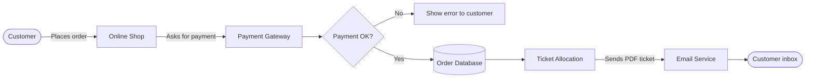

# How an online ticket order is handled

What happens behind the scenes after a customer presses "Buy".

1. The customer picks a ticket on the website and presses **Buy**.
2. The shop never touches card details. It hands the customer to the payment gateway.
3. The gateway checks the card with the bank and reports back.
4. If the payment fails, the customer sees a clear message and can try again. Nothing is charged.
5. If the payment succeeds, the order is saved as **paid**.
6. A paid order automatically triggers ticket allocation. No staff action is needed.
7. The ticket (code or PDF) is attached to an email.
8. The customer receives the ticket, usually within a minute.

- **Ticket Allocation**: Picks one unused ticket from the vendor's stock and locks it to this order, so the same ticket can never be sent twice.
- **Order Database**: The single record of who bought what. Staff can look up any order here.
