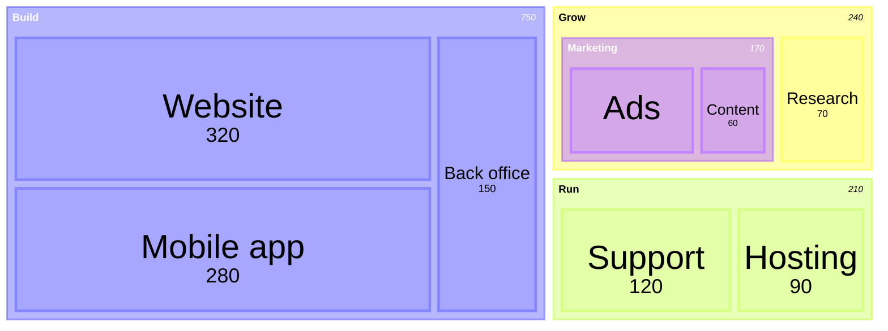

# Where this year's budget goes

How the HK$1.2M project budget is split.

1. Most of the money goes into building the product: the website, the app and the staff back office.
2. Keeping it running costs about a sixth of the budget, mostly support.
3. The rest is for growth: advertising, content and talking to customers.
